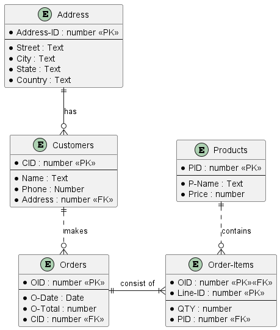
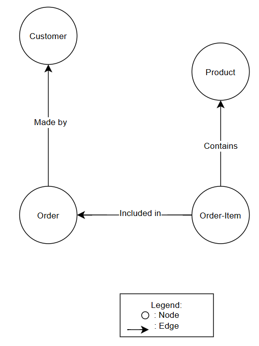
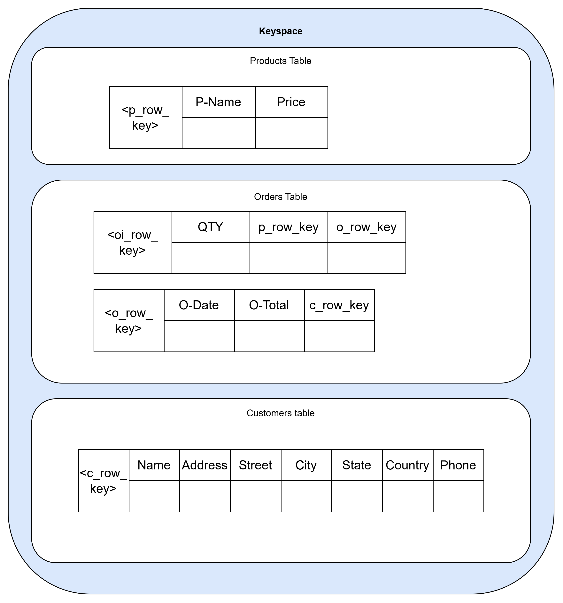
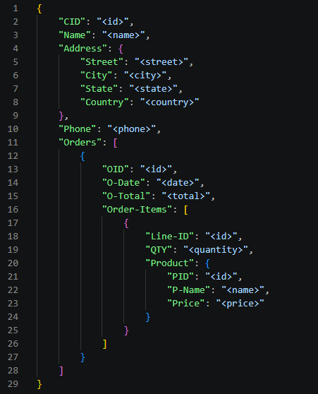

# Data-Intensive Systems database schema modeling assignment

PlantUML and draw.io were used to generate the diagrams.

## Database entities
- CUSTOMERS(CID, NAME, ADDRESS (STREET, CITY, STATE, COUNTRY), PHONES)
- ORDERS(OID, CID, O-DATE, O-TOTAL)
- ORDER-ITEMS(OID, LINE-ID, PID, QTY)
- PRODUCTS(PID, P-NAME, PRICE)

## ER Model

## Graph database schema

## Wide-column schema

## JSON data representation
